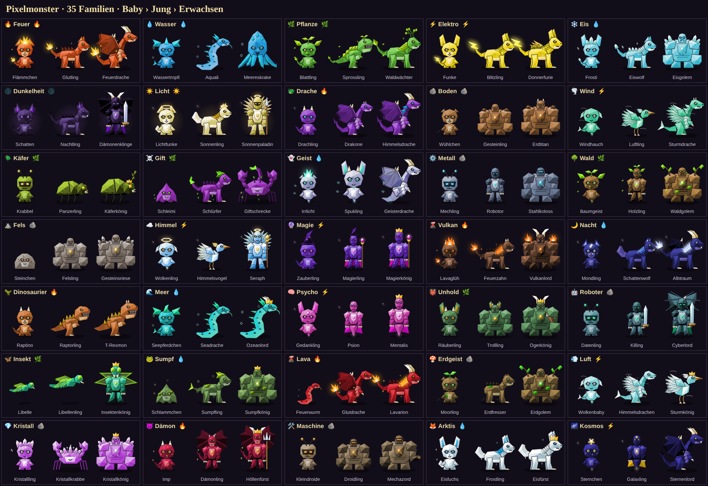

# Pixelmonster

Zieh dein eigenes Monster groß, schick es zu Freunden auf Besuch, kämpfe und züchte. Es gibt 35 Monster-Familien mit je drei Stufen.

## Herunterladen (Windows)

1. Lade die neueste `Pixelmonster-Windows.zip` herunter: **[Neueste Version](https://github.com/Enchio86/Pixelmonster/releases/latest)**
2. Entpacke die ZIP und starte `Pixelmonster.exe`.
3. Windows warnt beim ersten Start, weil die App nicht signiert ist. Klicke dann auf **Weitere Informationen** → **Trotzdem ausführen**.

Updates kommen danach automatisch. Oben im Fenster erscheint „🆕 Version … ist bereit“, und dein Spielstand bleibt erhalten.

## Ordner

- `update/` – die aktuelle Spielversion, die die App automatisch lädt
- `desktop-app/` – die Windows-App (Electron)
- `server/` – der Online-Treffpunkt (Cloudflare Worker)
